  <!-- Animated cybersecurity banner (file: assets/cyber-banner.svg) -->
  

  <h1 align="center">Wong Jun Xiang</h1>

  <h3 align="center">Network &amp; Security Student</h3>

  

    <strong>Universiti Teknologi Malaysia (UTM)</strong> 
    <em>Exploring networks. Understanding security. Building the future.</em>
  

  <!-- Badges -->
  

    
    
    
  

  

    
    
  

  

 

## 🔹 01 / ABOUT ME

> 👋 Hi! I'm **Jun Xiang**, a Network &amp; Security student at **Universiti Teknologi Malaysia (UTM)**.

| | |
|---|---|
| 🎓 **Education** | Network &amp; Security, Universiti Teknologi Malaysia (UTM) *(Expected Graduation: [2029])* |
| 💡 **Passion** | Understanding how computer networks operate, how digital systems communicate, and how technology can be protected against security threats. |
| 🛠️ **Foundation** | Building my technical foundation through programming, networking, and cybersecurity. |
| 🏆 **Highlight** | National finalist at **ASEAN DSE 2026** with a food security app. |

**🎯 Career Goals**

- 🌐 Build practical networking projects.
- 💻 Develop programming and problem-solving skills.
- 🕵️‍♂️ Explore cybersecurity and ethical hacking.
- 🌍 Create projects that solve real-world problems.

## 🔹 02 / CURRENTLY LEARNING

  
  
  
  

## 🔹 03 / AREAS OF INTEREST

| 🔒 Network Security | 🛡️ Cybersecurity | 🕵️‍♂️ Ethical Hacking |
|:---:|:---:|:---:|
| 🐧 **Linux &amp; SysAdmin** | 🔌 **Network Infrastructure** | 🌱 **Food Supply Chain Tech** |

## 🔹 04 / TECHNICAL SKILLS &amp; TOOLS

  
  
  
  

## 🔹 05 / FEATURED PROJECTS

<table>
  <tr>
    <td width="50%" valign="top">
      <h3 align="center">🌾 ASEAN DSE 2026 Food Security App</h3>
      

        
        
      

      
A team project for the <strong>ASEAN Data Science Explorer 2026</strong>: a food security app focused on the food supply chain, from crop to food.

      <ul>
        <li>Idea developed and refined from an initial concept into a food security solution</li>
        <li>Advanced to the <strong>national final</strong>, presented over Zoom</li>
        <li>Slides and certificate included in the repository</li>
      </ul>
      

        <a href="[ASEAN DSE Repository Link]"><strong>📁 GitHub Repository</strong></a>
      

    </td>
    <td width="50%" valign="top">
      <h3 align="center">🚀 Next Project Coming Soon</h3>
      

        
        
      

      
A hands-on C++ networking or security project is in the works. Stay tuned!

      <ul>
        <li>[Key feature or implementation detail A]</li>
        <li>[Key feature or implementation detail B]</li>
      </ul>
      

        <a href="[Project 2 Repository Link]"><strong>📁 GitHub Repository</strong></a>
      

    </td>
  </tr>
</table>

## 🔹 06 / GITHUB STATISTICS

  
  

 

  

## 🔹 07 / ACHIEVEMENTS &amp; CERTIFICATIONS

- 🏆 **ASEAN DSE 2026 National Finalist:** Food security app project, advanced to the national final *(2026)*.
- 📜 **Certificate:** ASEAN DSE 2026 National Final [[View Certificate]]([https://github.com/JUNXIANG0906/asean-dse-2026]/tree/main/certificate)

## 🔹 08 / CONTACT INFORMATION

> Feel free to reach out for network &amp; security collaborations, academic discussions, or general networking!

- ✉️ **Email:** `[junxiangwong962007@gmail.com]`
- 💼 **LinkedIn:** [linkedin.com/in/[your-username]](https://linkedin.com/in/[your-username])
- 🌐 **Personal Website / Portfolio:** [[yourwebsite.com]](https://[yourwebsite.com])

### 🛡️ LEARN. BUILD. SECURE.

*Always curious. Always improving.*

